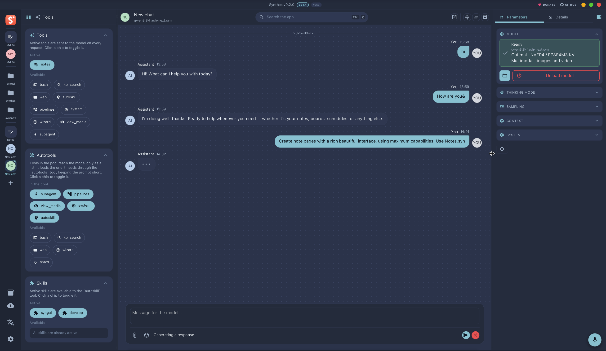
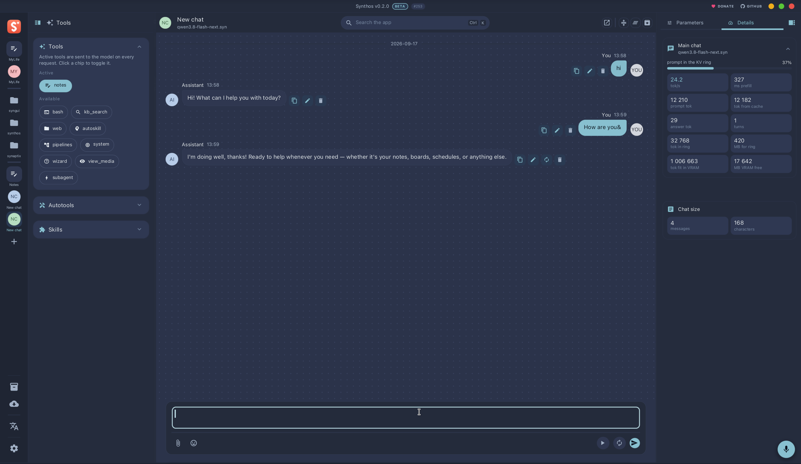
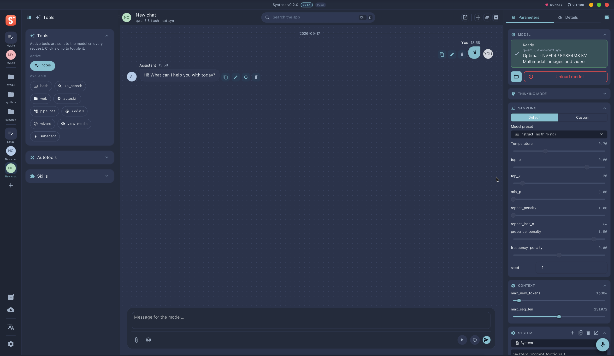
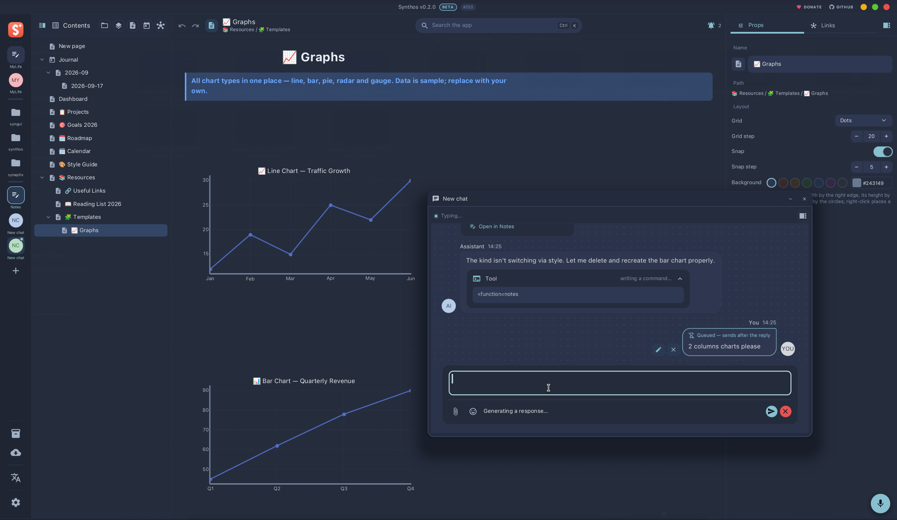
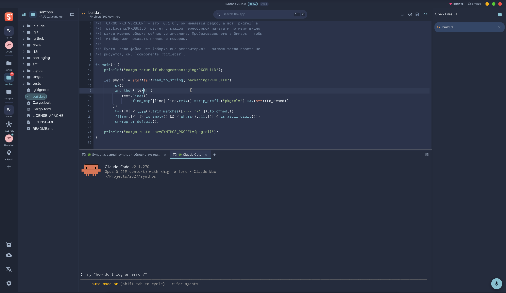
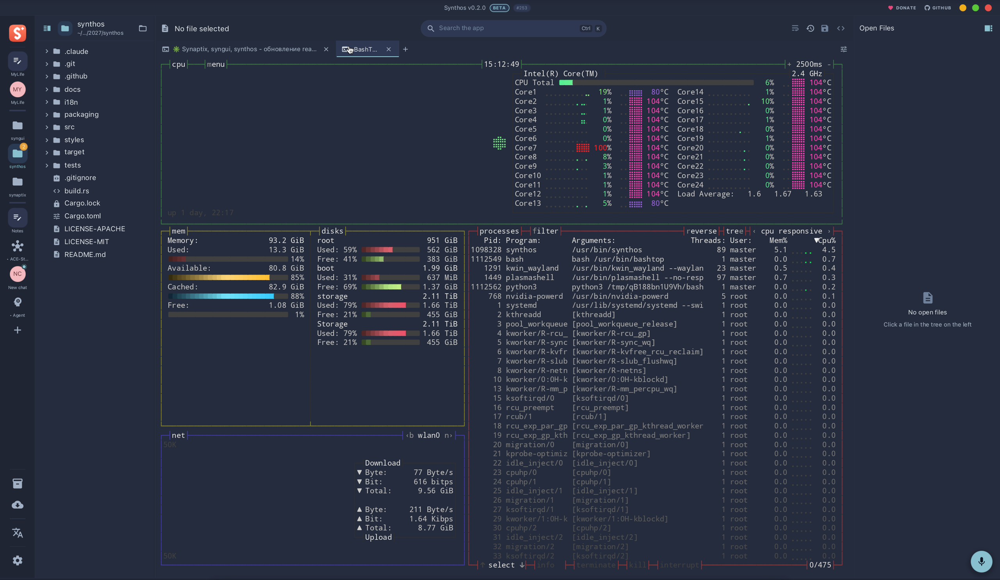

# synthos

[](#licence)
[](#requirements)

A local AI desktop studio written in Rust — an agentic chat client that also generates images,
video, music and speech, a document knowledge base and a code editor with persistent terminals.
Everything runs on-device on the native [synaptix](https://github.com/VitaminDB/synaptix)
engine inside the system `synaptixd` service: no Python, no torch, no cloud. It runs on any NVIDIA GPU from sm_80 (Ampere) up —
natively on Blackwell (sm_120+), through portable kernels on older cards — and loads models
from `.syn` bundles in the precision you choose (NVFP4, MXFP8, SQ1…SQ8, dense) or chat
models straight from GGUF. The UI is built with [syngui](https://github.com/VitaminDB/syngui).



## Status

Early. One developer, one machine, and — as far as I know — no users other than
myself. Everything described below works on my hardware (RTX 5090 Laptop, 24 GB,
Arch Linux); how much of it survives contact with a different GPU, driver or
distribution is exactly what I don't know yet. Bug reports with your hardware
details are more useful to me right now than stars — there is an
[issue form](https://github.com/VitaminDB/synthos/issues/new/choose) for exactly that.

## What it is

synthos is one desktop app around a local GPU. A chat client runs 27B–125B models from
single-file `.syn` bundles or GGUF files and drives the rest through tools: it generates
images, video, music and speech with the `generate` tool, writes into your notes, searches
your knowledge base, runs commands and reads the web. Next to the chat live a code editor
with terminals that survive restarts. Nothing leaves the machine.

**What moved out.** synthos used to carry more modes; they now live elsewhere:

- **Notes** — the separate [synshell](https://github.com/VitaminDB/synshell) app `syn-notes`.
  The agent's `notes` tool keeps working: synthos hands each call to `syn-notes` over its
  socket (starting it in the background if needed), and the edits show up in its window.
- **Hugging Face browser, `.syn` packages and LoRA training** (download, pack, inspect,
  repack; datasets, training jobs, adapters) — the synshell app **Models** (`syn-models`),
  tabs Hugging Face / Library / Settings / Training. **Settings → General → Models**, the
  global search and the chat's LoRA card open it. Trained adapters are switched on per chat
  in the chat's LoRA card, as before.
- **The built-in engine** — synthos no longer links synaptix at all: chat, generation,
  speech recognition, the knowledge base's embeddings, reranking and token boundaries are
  requests to the `synaptixd` service (package `synaptix`). The app itself is a light client.
- **The node editor (graphs and templates)** — retired. Generation is done by the agent with
  `generate`, straight through the `synaptixd` service; the video editor of synshell has
  its own node graphs.

## Install

**Arch Linux (AUR)**

```sh
paru -S synthos-bin      # prebuilt binary from the latest release — recommended
paru -S synthos-git      # build from source
```

**Neural networks run in the system `synaptixd` service** (package `synaptix`, a dependency
of the synthos package). synthos is its client: models loaded there are shared with every
synshell app, so a model is never held in VRAM twice. Without the service the editor,
terminals and notes work; the chat, generation, voice input and knowledge base wait for it.

**Other distributions** — download the tarball from
[Releases](https://github.com/VitaminDB/synthos/releases) or build from source (see
[Build](#build)). The binary is built against Arch's library versions; on other
distributions building from source is the reliable path.

**Then pack your models** — synthos loads `.syn` bundles (chat models can also be opened
straight from `.gguf`), see [the next section](#models-pack-them-into-syn-first).

## Models: pack them into `.syn` first

**synthos loads models from `.syn` bundles.** A model downloaded from Hugging Face as a
folder of safetensors shards with `config.json` and tokenizer files has to be packed into a
single `.syn` file before the chat or the agent can use it. It is a
one-time step per model. The one exception is **GGUF**: a llama.cpp `.gguf` chat model
(Llama, Qwen2/Qwen3 dense and MoE, the Qwen3.6/3.8 hybrids, Gemma-3, Gemma-4) opens
directly in the chat model picker, with its ggml quantization
executed as is — packing it into `.syn` is optional.

Why one file: the bundle is read zero-copy through mmap, carries the config, tokenizer and
chat template together with the weights, and can hold quantized weights in several formats —
NVFP4 and MXFP8 (native on Blackwell), SQ1…SQ8 (a portable block format for any sm_80+
card), ggml blocks kept byte for byte from a GGUF, or dense BF16/F16 — mixed per layer group.
The file on disk is exactly what gets loaded, with nothing to resolve at runtime; a quantized
bundle can also be transcoded on load into the format that suits the card.

**How:** download and pack models in the synshell app **Models** (`syn-models`): its
Hugging Face browser fetches a model, and its package library builds a `.syn` (architecture,
components and auxiliary files are detected by themselves; quantization and per-layer-group
precision are optional), inspects and repacks bundles, and converts a GGUF without
re-quantizing. From a terminal, `synaptix convert <source> <model.syn>` from
[synaptix](https://github.com/VitaminDB/synaptix) does the same. Put the result into your
models directory (default `~/Storage/syn_models`, set in **Settings → AI models → Models
directory**) — the chat, the knowledge base and the global search find bundles there and in
the Models app's package bookmarks.

**Before you press Build:**

- **Quantization (NVFP4 / MXFP8 / SQ1…SQ8) needs an NVIDIA GPU and is lossy.** Without a
  Blackwell card prefer SQ (SQ4–SQ8): NVFP4 / MXFP8 still run there, but through slower
  dequantizing kernels. Keep the original weights if you quantize — the dialog will not
  combine quantization with "delete sources
  after packing".
- Large multi-part models have packing notes of their own: LTX-2.3 with its Gemma text
  encoder, MiniMax-H3, Muse Glimmer, Qwen3.8 and YuE2 — see `docs/*_syn_bundle_2026.md`
  and `docs/yue2_2026.md`.

## Features

### Chat and agent

- **Native inference from `.syn` bundles and GGUF** — NVFP4 / MXFP8 / SQ1…SQ8 and all ggml
  quantization types, on any sm_80+ card (native block-scale MMA on Blackwell), CUDA-graph decode,
  MTP and DFlash speculative decoding, prefix-KV reuse across turns (including prompts that
  carry images), a VRAM-aware context budget with automatic compaction, and partial block
  offload that streams layers from host RAM when the model does not fit.
- **Models** — Qwen3 (dense and MoE), the Qwen3.6 / 3.8 hybrids (GatedDeltaNet + full
  attention), Qwen3.8-Flash-Next (125B MoE with a sparse-attention indexer, runs on a 24 GB
  card), Gemma-3, Gemma-4 26B A4B, Muse Glimmer 30B and Llama. Vision towers where the model
  has one — images and video go straight into the prompt.
- **Attachments** — images and video to the vision tower, documents inlined, audio
  transcribed on device; generated pictures, video and audio play right in the thread, in
  the same video player the viewer uses (audio-clocked, ±1 s jumps, seek on a paused frame).
- **Agent tools** — web search and read, knowledge-base retrieval, system status (VRAM / RAM,
  loaded models), **generate** (images, video, music and speech through the `synaptixd`
  service — see below), **notes** (full read/write access to pages, blocks, boards and the
  calendar of the synshell `syn-notes` app), `view_media` (look at a file with the model's own vision),
  a `wizard` that asks you a multiple-choice question mid-turn, subagents, user-defined
  skills, and voice input. Tool schemas are not all declared up front: with **autotools** the
  model pulls the schema it needs on demand, which keeps the prefix-KV intact.
- **The thread stays fast and honest** — the feed is virtualized (a 400-message history
  re-renders in single-digit milliseconds), generation survives switching chats, messages you
  send mid-turn queue up instead of being dropped, and every message can be edited or deleted
  in place.
- **Per-chat setup** — a library of system prompts, sampling presets (per-model defaults or
  your own), reasoning depth, a collapsible card for each side panel, and a chat can be torn
  off into a floating window.

<details>
<summary>More chat screenshots</summary>

| | |
|---|---|
|  |  |
| Tools, the autotools pool and skills — toggled per chat | Details: tok/s, prefill time, and how much of the prompt came from the prefix-KV cache |
|  |  |
| Model card and sampling — per-model presets or your own | A floating chat, with a message queued mid-turn |

</details>

### Generation from the chat

The agent's `generate` tool sends a request straight to the `synaptixd` service; the service
shares VRAM between the chat model and the generator, so nothing has to be unloaded by hand.
The result lands in the thread as an attachment.

- **Images** — FLUX.1 (dev), FLUX.2 (dev 32B, klein 4B/9B, klein base), Qwen-Image 2.1
  (text-to-image, editing by up to ten references, transparent RGBA), Qwen-Image-Edit and
  Edit-2509/2511, SDXL.
- **Video** — LTX-2.3 and MiniMax-H3: text, first frame (or first + last) → video with sound.
- **Music** — YuE2 and ACE-Step.
- **Speech** — VoxCPM2 and OmniVoice with zero-shot voice cloning, VibeVoice for multi-speaker
  dialogue.

### Code editor

- Tree view with live git-status decorations, external-change watching, syntax highlighting,
  integrated terminals. With no file open the editor steps aside and the terminal takes the
  centre.
- Terminals survive restarts and crashes (Settings → Terminal, on by default): a separate holder
  process (`synthos --pty-holder`, started on demand, exits when idle) owns the PTYs, and on the
  next start the tabs reattach to the running programs with their screen restored. A terminal the
  holder keeps but no tab shows is put back into its project's session.
- Command line: `synthos --open-terminal <dir> [--cmd '<command>'] [--title <title>]` opens a
  terminal tab in that project (the command is typed into the tab's shell), `synthos
  --list-terminals` lists the holder's terminals. A second `synthos` hands its arguments to the
  running one and raises its window instead of opening another.

| | |
|---|---|
|  |  |
| Code editor with the integrated terminal | The terminal runs full-screen TUIs |

### Knowledge base (RAG)

- Local document collections (files, folders, PDF, URL), hybrid BM25 + vector search and an
  optional cross-encoder rerank — computed on-device, stored in bundled SQLite.

### Models

- A model catalogue in Settings — one `.syn` file per model, read zero-copy via mmap, with
  "optimal" and "custom" profiles per model.
- Downloading from Hugging Face and packing, inspecting and repacking `.syn` bundles — in the
  synshell app **Models** (`syn-models`), started from the rail.

### Desktop

- A global voice-input overlay (FAB) on every page, with history.
- System appearance: follows the desktop's light/dark scheme, accent colour, title-bar
  buttons and backdrop blur. UI scale for HiDPI.
- The interface ships in 14 languages (en, ru, de, es, fr, it, ja, kk, ko, pl, pt-BR, tr, uk,
  zh-CN).

## Performance

Measured on an RTX 5090 Laptop (24 GB) with 93 GB of system RAM — a single consumer machine,
not a server card:

| Model | Prefill | Decode |
|---|---|---|
| Gemma-4 26B A4B | 10 100 tok/s (4k prompt) | 210 tok/s |
| Qwen3.8-27B hybrid | 1 450 tok/s (3.3k prompt) | 47 tok/s (MTP + CUDA graph) |
| Qwen3.8-Flash-Next 125B MoE | 1 650 tok/s at a 260k context | 17–22 tok/s |

The 125B model holds a 262k-token context on a 24 GB card: experts live in pinned host RAM
and stream in at ~39 GB/s, the KV cache is MXFP8, and prefill runs layer-by-layer so a long
prompt never needs three copies of the activation stream. A 3k-token follow-up turn on top of
an 80k history takes 3.3 s thanks to prefix-KV reuse.

Image generation on the same card, 1024²: SDXL 30 steps in 6.5 s, Qwen-Image 2.1 40 steps
in 30 s (MXFP8, 13.6 GB peak) or 23 s (NVFP4) — 2048² in 172 s, Qwen-Image-Edit-2511
40 steps in 188 s (MXFP8, 17.8 GB peak) or 155 s (NVFP4), FLUX.2 klein 4 steps in a few
seconds.

**A 7 GB card is enough for all of it.** Every model family was measured with a ballast
process holding all but 7 GB of VRAM: chat models from 27B to a 125B MoE, Gemma-4, FLUX.1,
FLUX.2, MiniMax-H3, LTX-2.3, ACE-Step with its 4B LM, VibeVoice. What does not fit streams
from RAM (or from the mmapped bundle), so the limit is patience rather than capacity — a
27B hybrid answers at 1–2 tok/s with 7 of its 64 blocks resident, while FLUX.2 klein still
draws a 1024² image in 2–3 s. Details in `docs/small_vram_7gb_2026.md`.

## Build

synthos is a Cargo workspace that path-depends on its sibling repositories — syngui (UI)
and synshell (the `synaptixd` client, the assistant crate and the notes protocol and
helpers); synshell crates in turn take the `.syn` container crate from synaptix. Check
all four out next to each other:

```
~/Projects/
├── syngui/
├── synaptix/
├── synshell/
└── synthos/
```

```sh
cargo build --release            # or --profile fast-release for iteration
```

The build needs stable Rust 1.96 or newer (the floor set by dependencies) and system FFmpeg
development libraries; no CUDA toolkit — the engine lives in the service. Packages and
releases are built with the [`syngui`](https://github.com/VitaminDB/syngui) CLI
(`syngui package -f arch --install`, `syngui release <version> --publish`); the metadata lives
in `[package.metadata.syngui]` in `Cargo.toml`.

## Requirements

- Linux x86_64. Runtime: gtk3, wayland, libxkbcommon, fontconfig, a Vulkan driver, alsa,
  ffmpeg.
- GPU (optional, strongly recommended): NVIDIA driver + CUDA runtime, loaded at runtime. The
  kernels are JIT-compiled for the card: any sm_80+ GPU (Ampere, Ada, Hopper) is supported
  through portable kernels, while Blackwell (sm_120+) keeps native NVFP4 / MXFP8 tensor-core
  paths. 7 GB of VRAM is enough to run everything, 24 GB to run it quickly. Without a GPU the engine falls back
  to CPU for smoke tests and debugging.
- A Windows build is planned — the app currently depends on Linux-only components.

## Models and licences

No model weights are shipped. Download them yourself from Hugging Face — the same files used
by ComfyUI / LM Studio — and you accept each model's licence. Some models (e.g. FLUX.1-dev,
LTX-2.3, Gemma-3) are non-commercial or otherwise restricted; check the licence before use.
Every model except a GGUF chat model must be packed into a `.syn` bundle before use — see
[Models: pack them into `.syn` first](#models-pack-them-into-syn-first).

## Documentation

Feature notes and design write-ups live in [`docs/`](docs/) (Russian) — including the
performance analyses quoted above (`qwen4exp_perf_2026.md`, `gemma4_2026.md`,
`block_offload_2026.md`).

## Related

- [syngui](https://github.com/VitaminDB/syngui) — the GUI framework.
- [synaptix](https://github.com/VitaminDB/synaptix) — the inference and training engine.

## How it is tested

Every number in this README was measured on my machine, with the losses reported next to the
wins. It is my own daily code editor and chat. Developed with the help of [Claude
Code](https://claude.com/claude-code).

## FAQ

**Why a custom `.syn` format instead of GGUF or safetensors?**
The bundle is mmapped zero-copy and carries the config, tokenizer and chat template
next to the weights, so what is on disk is exactly what gets loaded — nothing is
resolved at runtime. It also holds quantized weights and multi-part models (a video
model with its text encoder, a music model with its LM) as one file. GGUF chat models
load directly, and the synshell Models app can convert a GGUF to `.syn`, `mmproj`
included.

**Why not just use llama.cpp / ComfyUI / LM Studio?**
For chat alone, use llama.cpp — it is more portable and far better tested. For
diffusion workflows, ComfyUI has an ecosystem this will never match. synthos exists
because I wanted one process where the same allocator and the same VRAM budget serve
an LLM, a diffusion model and TTS at once, with an agent that generates video and music
from the chat while the service keeps the VRAM budget. That is hard to build on top of
several separate tools, so the engine is written from scratch.

**Why Linux and NVIDIA only?**
The engine is CUDA (sm_80 baseline, native NVFP4 on sm_120), and the app depends on
Linux-only components. A Windows build is planned. ROCm and Metal are not.

**Do I need a 24 GB card?**
No. Every model family has been measured on 7 GB of usable VRAM — what does not fit
streams from host RAM or straight from the mmapped bundle. The limit becomes patience
rather than capacity: a 27B hybrid answers at 1–2 tok/s with 7 of its 64 blocks
resident. See [`docs/small_vram_7gb_2026.md`](docs/small_vram_7gb_2026.md).

## Support

synthos is free and open source, written by one person. If it is useful to you, you can
support its development with a donation via [PayPal](https://paypal.me/vitamindbnfkz).

## Licence

Synthos is dual-licensed: free under the [GNU GPL v3.0](LICENSE) (with an [additional permission](LICENSE-EXCEPTION.md) for proprietary GPU/NPU runtime libraries), or under a [commercial licence](LICENSE-COMMERCIAL.md) for companies that ship it in closed-source products. Versions up to 15 October 2026 remain under MIT OR Apache-2.0.
